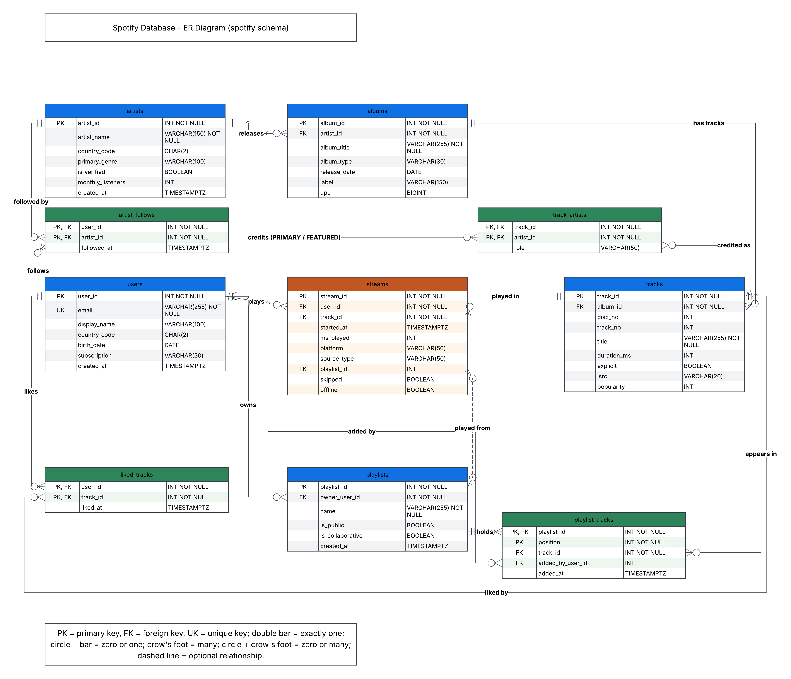

# Phase 2 – Schema Design

**Team:** 008 | **Lead:** Roshni Singh | **Members:** Madhav Khandelwal , Tishika Arora , Mahabir Shaw

---

## How we figured out the schema

We opened every CSV file, checked the column headers, looked at sample rows, and answered these questions for each table:
- What type does each column need? (A number? A flag? A timestamp with timezone? A short code?)
- What is the primary key? (We counted rows against distinct key values to prove it.)
- Which columns point to other tables? (We checked each one for orphan rows.)
- Which columns can be empty, and why?
- What values are allowed?

The schema in `sql/01_schema.sql` was loaded with all 10 CSV files (`sql/02_load_data.sql`) and every row was accepted. All counts and checks below were measured on the real data.

Everything is in the `spotify` schema: `CREATE SCHEMA IF NOT EXISTS spotify; SET search_path TO spotify;`

**Time zone note:** every timestamp in the CSV files ends in +05:30, so all time columns are TIMESTAMPTZ, and date checks were run with SET TIME ZONE 'Asia/Kolkata'

**Important about NULLs:** in the CSV files, only one column has empty cells: `streams.playlist_id` (137,386 rows). Many other columns are *allowed* to be NULL in the schema, but the data contains **no NULL** in them.

---

## Data Dictionary

### Table: `users`
| Column | Type | Constraint | Why |
|--------|------|-----------|-----|
| user_id | INT | PK | 30,000 users; INT is enough |
| email | VARCHAR(255) | NOT NULL, UNIQUE, CHECK `LIKE '%@%._%'` | Login identity. All 30,000 are distinct, and all are stored in lower-case |
| display_name | VARCHAR(100) | NULL ok | No NULLs in data; names repeat (325 distinct), so not UNIQUE |
| country_code | CHAR(2) | NULL ok, CHECK `^[A-Z]{2}$` | Always 2 capital letters (AE, GB, IN, US) |
| birth_date | DATE | NULL ok | No NULLs; range 1965-02-12 to 2014-04-13; needed for the age check in R12 |
| subscription | VARCHAR(30) | NULL ok | Data has 5 values: FREE, PREMIUM, DUO, FAMILY, STUDENT |
| created_at | TIMESTAMPTZ | NULL ok | Sign-up time with offset |

### Table: `artists`
| Column | Type | Constraint | Why |
|--------|------|-----------|-----|
| artist_id | INT | PK | 3,000 artists |
| artist_name | VARCHAR(150) | NOT NULL | Every artist has a name; not UNIQUE (names are unique in the data by chance, not by rule) |
| country_code | CHAR(2) | NULL ok, CHECK `^[A-Z]{2}$` | IN, PK, KR, US, GB |
| primary_genre | VARCHAR(100) | NULL ok | 10 genres, 300 artists each |
| is_verified | BOOLEAN | NULL ok | `t`/`f` in CSV; 334 true |
| monthly_listeners | INT | NULL ok, CHECK `>= 0` | **Derived** value refreshed by W04; range 0–120 |
| created_at | TIMESTAMPTZ | NULL ok | Profile creation time |

### Table: `albums`
| Column | Type | Constraint | Why |
|--------|------|-----------|-----|
| album_id | INT | PK | 12,000 albums |
| artist_id | INT | NOT NULL, FK → artists | Every album has one main artist |
| album_title | VARCHAR(255) | NOT NULL, CHECK not blank | |
| album_type | VARCHAR(30) | NULL ok, CHECK IN (ALBUM, EP, SINGLE, COMPILATION) | The four release kinds from the README |
| release_date | DATE | NULL ok | No NULLs; 2012-01-03 to 2026-06-25 |
| label | VARCHAR(150) | NULL ok | 8 labels in the data |
| upc | BIGINT | NULL ok, CHECK 12 digits (`upc::TEXT ~ '^[0-9]{12}$'`) | All UPCs have 12 digits and start with `100`, so no leading zeros are lost in BIGINT |

### Table: `tracks`
| Column | Type | Constraint | Why |
|--------|------|-----------|-----|
| track_id | INT | PK | 67,808 tracks |
| album_id | INT | NOT NULL, FK → albums | A track always lives on an album |
| disc_no | INT | NULL ok, CHECK `>= 1` | Values 1–2 |
| track_no | INT | NULL ok, CHECK `>= 1` | Values 1–16 |
| title | VARCHAR(255) | NOT NULL | Only 66 distinct titles, so it can never be UNIQUE |
| duration_ms | INT | NULL ok, CHECK `> 0` | Milliseconds (same unit as `ms_played`); 90,008–329,994 |
| explicit | BOOLEAN | NULL ok | 7,576 true; used by R12 |
| isrc | VARCHAR(20) | NULL ok, CHECK `^[A-Za-z0-9]{12}$` | In the data every ISRC is exactly 12 characters and is unique |
| popularity | INT | NULL ok, CHECK 0–100 | Data range is 36–100 |

### Table: `track_artists`
**Composite PK: `(track_id, artist_id)`**. This is unique in all 77,489 rows.

| Column | Type | Constraint | Why |
|--------|------|-----------|-----|
| track_id | INT | PK (part 1), FK → tracks | |
| artist_id | INT | PK (part 2), FK → artists | |
| role | VARCHAR(50) | NULL ok, CHECK not blank | Data has only PRIMARY (67,808) and FEATURED (9,681); R05 and R09 read these words |

### Table: `playlists`
| Column | Type | Constraint | Why |
|--------|------|-----------|-----|
| playlist_id | INT | PK | 10,000 playlists |
| owner_user_id | INT | NOT NULL, FK → users | A playlist always has an owner |
| name | VARCHAR(255) | NOT NULL, CHECK not blank | |
| is_public | BOOLEAN | NULL ok | 6,317 true; R13 filters on it |
| is_collaborative | BOOLEAN | NULL ok | 968 true; R14 filters on it |
| created_at | TIMESTAMPTZ | NULL ok | |

### Table: `artist_follows`
**Composite PK: `(user_id, artist_id)`**. This is unique in all 69,901 rows.

| Column | Type | Constraint | Why |
|--------|------|-----------|-----|
| user_id | INT | PK (part 1), FK → users | |
| artist_id | INT | PK (part 2), FK → artists | |
| followed_at | TIMESTAMPTZ | NULL ok | |

### Table: `liked_tracks`
**Composite PK: `(user_id, track_id)`**. This is unique in all 58,533 rows. W02's `ON CONFLICT (user_id, track_id)` needs exactly this key.

| Column | Type | Constraint | Why |
|--------|------|-----------|-----|
| user_id | INT | PK (part 1), FK → users | |
| track_id | INT | PK (part 2), FK → tracks | |
| liked_at | TIMESTAMPTZ | NULL ok | |

### Table: `playlist_tracks`
**Composite PK: `(playlist_id, position)`**. It is **not** `(playlist_id, track_id)`, because 1,800 playlist/track pairs appear twice.

| Column | Type | Constraint | Why |
|--------|------|-----------|-----|
| playlist_id | INT | PK (part 1), FK → playlists | |
| position | INT | PK (part 2), CHECK `>= 1` | Order inside the playlist (1–20 in the data); no upper limit, because W03 appends `max(position)+1` |
| track_id | INT | NOT NULL, FK → tracks | The track at that position |
| added_by_user_id | INT | **NULL ok**, FK → users | No NULLs in data; nullable so a missing contributor is allowed |
| added_at | TIMESTAMPTZ | NULL ok | |

### Table: `streams`
This is the central fact table with 250,000 rows.

| Column | Type | Constraint | Why |
|--------|------|-----------|-----|
| stream_id | INT | PK | Plain integer, not an identity column: W01 supplies the value |
| user_id | INT | NOT NULL, FK → users | Every stream has a user |
| track_id | INT | NOT NULL, FK → tracks | Every stream plays one track |
| started_at | TIMESTAMPTZ | NULL ok | No NULLs; 2025-01-01 to 2026-06-30 |
| ms_played | INT | NULL ok, CHECK `>= 0` | Milliseconds; 3 streams have exactly 0 |
| platform | VARCHAR(50) | NULL ok | Data has 6 values: ANDROID, IOS, WEB, DESKTOP, CAR, SPEAKER |
| source_type | VARCHAR(50) | NULL ok | Data has 5 values: PLAYLIST, ALBUM, ARTIST, RADIO, SEARCH; never NULL |
| playlist_id | INT | **NULL ok**, FK → playlists | NULL means "not played from a playlist" (137,386 rows). **Real NULLs exist here** |
| skipped | BOOLEAN | NULL ok | 55,105 true; used by R08 |
| offline | BOOLEAN | NULL ok | 17,472 true. W01 does not set it, so a new stream gets NULL here |

---

## Summary of Constraints in the Schema

| Kind | Count | Notes |
|------|------:|-------|
| PRIMARY KEY | 10 | 4 are composite (`track_artists`, `artist_follows`, `liked_tracks`, `playlist_tracks`) |
| FOREIGN KEY | 15 | 0 orphan rows in the data |
| UNIQUE | 1 | `users.email` |
| CHECK | 16 | The full dataset passes all of them |
| NOT NULL columns | 25 of 60 | Includes the 10+ key columns |
| ON DELETE | not set | Default `NO ACTION`: a parent row with children cannot be deleted |

**The 16 CHECK constraints:**

| # | Table | Rule | Data passes? |
|--:|-------|------|:-----------:|
| 1 | users | `email LIKE '%@%._%'` | Yes |
| 2 | users | `country_code IS NULL OR country_code ~ '^[A-Z]{2}$'` | Yes |
| 3 | artists | `country_code IS NULL OR country_code ~ '^[A-Z]{2}$'` | Yes |
| 4 | artists | `monthly_listeners IS NULL OR monthly_listeners >= 0` | Yes |
| 5 | albums | `LENGTH(TRIM(album_title)) > 0` | Yes |
| 6 | albums | `album_type IS NULL OR album_type IN ('ALBUM','EP','SINGLE','COMPILATION')` | Yes |
| 7 | albums | `upc IS NULL OR upc::TEXT ~ '^[0-9]{12}$'` | Yes |
| 8 | tracks | `disc_no IS NULL OR disc_no >= 1` | Yes |
| 9 | tracks | `track_no IS NULL OR track_no >= 1` | Yes |
| 10 | tracks | `duration_ms IS NULL OR duration_ms > 0` | Yes |
| 11 | tracks | `isrc IS NULL OR isrc ~ '^[A-Za-z0-9]{12}$'` | Yes |
| 12 | tracks | `popularity IS NULL OR popularity BETWEEN 0 AND 100` | Yes |
| 13 | playlists | `LENGTH(TRIM(name)) > 0` | Yes |
| 14 | playlist_tracks | `position >= 1` | Yes |
| 15 | track_artists | `role IS NULL OR LENGTH(TRIM(role)) > 0` | Yes |
| 16 | streams | `ms_played IS NULL OR ms_played >= 0` | Yes |

Indexes that exist automatically: one for each PRIMARY KEY (10) and one for the UNIQUE on `users.email` (1), so **11 in total**. No other index has been created. PostgreSQL does **not** index foreign-key columns automatically (for example `streams.user_id` and `streams.track_id` have no index yet). That is Phase 4 work.

---

## ER Diagram

**Mermaid source**

[ER Diagram Mermaid](../diagrams/er_diagram.mmd)

**Relationships:**
- `artists` → `albums`: 1:N (one artist, many albums; 151 artists have none)
- `albums` → `tracks`: 1:N (one album, 1–16 tracks)
- `tracks` ↔ `artists`: M:N through `track_artists` (every track has exactly one PRIMARY artist)
- `users` → `playlists`: 1:N (one owner, many playlists)
- `playlists` ↔ `tracks`: M:N through `playlist_tracks` (the same track may appear twice in one playlist)
- `users` → `streams`: 1:N (one user, many streams)
- `tracks` → `streams`: 1:N (one track, many streams)
- `playlists` → `streams`: 1:N, **optional** (`playlist_id` may be NULL)
- `users` ↔ `tracks`: M:N through `liked_tracks`
- `users` ↔ `artists`: M:N through `artist_follows`

**Delete behaviour:** all 15 foreign keys use the default `NO ACTION`. A user, artist, album, track or playlist that still has child rows cannot be deleted until the child rows are removed first. This protects stream and catalogue history from accidental deletion.

---

## Normal Form Analysis

### Why each table is in 3NF/BCNF

**users:** PK is `user_id`. `email` is a candidate key (UNIQUE). All other columns depend only on `user_id`. **BCNF ✅**

**artists:** PK is `artist_id`. `monthly_listeners` is a **derived** column: the number of distinct users who streamed the artist in the last 28 days. We recomputed it for all 3,000 artists and it matched the stored value every time. We keep it because the artist page needs it fast, and W04 refreshes it. It is stale between refreshes. **3NF ✅ with noted justification.**

**albums:** PK is `album_id`. `artist_id → label` does not hold (2,369 artists have albums on more than one label), so there is no transitive dependency. **BCNF ✅**

**tracks:** PK is `track_id`. `(album_id, disc_no, track_no)` is unique in all 67,808 rows, and so are `isrc` values (so both are candidate keys in the data). The schema does not declare them UNIQUE. **BCNF ✅**

**track_artists:** PK is `(track_id, artist_id)`. `role` needs both parts: 2,849 artists are PRIMARY on some tracks and FEATURED on others. **BCNF ✅**

**playlists:** PK is `playlist_id`. All columns depend only on it. **BCNF ✅**

**playlist_tracks:** PK is `(playlist_id, position)`. `track_id`, `added_by_user_id` and `added_at` depend on the whole key. `(playlist_id, track_id)` is not a key because it repeats. **BCNF ✅**

**streams:** PK is `stream_id`. There is one derived column: `skipped`. In all 250,000 rows `skipped = (ms_played < 30000)`, so `ms_played → skipped` holds and the table is formally in 2NF but not 3NF. We keep `skipped` because R08 reads it directly and W01 inserts it, so it cannot be a generated column. **3NF ❌ (formally), kept on purpose.**

**liked_tracks / artist_follows:** PK is the pair; the only other column (`liked_at`, `followed_at`) depends on the whole pair. **BCNF ✅**

**Duplicated fact:** the main artist is stored both as `albums.artist_id` and as the PRIMARY row in `track_artists`. They match for all 67,808 tracks (0 mismatches). Both are needed: R11 joins `albums.artist_id`, and R09 uses `role = 'PRIMARY'`.

---

## Integrity Check Results

After loading all 10 CSV files into the schema:

| Check | What we tested | Result |
|-------|----------------|--------|
| IC1: Duplicate primary keys | Rows vs distinct key values, all 10 tables | **0 violations** ✅ |
| IC2: Orphan foreign keys | All 15 FKs (child rows with no parent) | **0 violations** ✅ |
| IC3: Duplicate email, UPC, ISRC | Email also compared in lower-case | **0 violations** ✅ |
| IC4: Exactly one PRIMARY artist per track | 67,808 tracks, 67,808 PRIMARY rows | **0 violations** ✅ |
| IC5: PRIMARY artist = album artist | All tracks | **0 violations** ✅ |
| IC6: Stream before album release | Dates in `Asia/Kolkata` | **0 violations** ✅ |
| IC7: `ms_played` above track duration | `streams` joined to `tracks` | **0 violations** ✅ |
| IC8: Skipped stream of 30 s or more | | **0 violations** ✅ |
| IC9: Playlist both public and collaborative | | **0 violations** ✅ |
| IC10: `(playlist_id, track_id)` unique? | Duplicate pairs | **1,800 duplicates** ❌ (so it cannot be a key) |

Row counts after load (matches the check query in `02_load_data.sql`):

| Table | Expected | Loaded |
|-------|----------|--------|
| artists | 3,000 | 3,000 |
| albums | 12,000 | 12,000 |
| tracks | 67,808 | 67,808 |
| track_artists | 77,489 | 77,489 |
| users | 30,000 | 30,000 |
| playlists | 10,000 | 10,000 |
| playlist_tracks | 120,004 | 120,004 |
| streams | 250,000 | 250,000 |
| liked_tracks | 58,533 | 58,533 |
| artist_follows | 69,901 | 69,901 |
| **Total** | **698,735** | **698,735** |

---

## What the Data Follows but the Schema Does Not Force

The CSV data obeys all of these rules, but `01_schema.sql` does not enforce them. We list them so the team knows what the database relies on the data for.

| Rule seen in the data | Schema today | Possible effect |
|-----------------------|--------------|-----------------|
| Only 5 subscription values | Any text up to 30 characters | A typo such as `'Free'` would be accepted and R17 (`= 'FREE'`) would miss it |
| Only 6 platform and 5 source_type values | Any text | Typos would create extra groups in R10 and R18 |
| `role` is only PRIMARY or FEATURED | Any non-blank text | R09 (`role = 'PRIMARY'`) would ignore any other word |
| `isrc` and `upc` are unique | Not UNIQUE | Duplicate codes would be accepted; R21 could return 2 rows |
| `isrc` is upper-case, 2 letters + 3 characters + 7 digits | Any 12 letters or digits | Lower-case codes accepted |
| `(album_id, disc_no, track_no)` is unique | Not enforced | Two tracks could take the same slot |
| Public and collaborative are never both true | Not enforced | Contradictory playlists accepted |
| A skipped stream is under 30 s | Not enforced | A skipped 60-second stream is accepted |
| `playlist_id` is present only when `source_type = 'PLAYLIST'` | Not enforced | A search stream could carry a playlist |
| `offline` is always true or false | NULL allowed | W01 stores NULL in `offline` |
| Emails are all lower-case | Case-sensitive UNIQUE | `A@x.com` and `a@x.com` could both be accepted |

We tested the schema with deliberately wrong values: it accepts `subscription = 'GOLD'`, `platform = 'TV'`, a skipped 60-second stream, a playlist that is public and collaborative, and a duplicate ISRC. None of these exist in the seed data. They could be added as extra constraints later without breaking the load.

---

## Data Problems Found

1. **NULL `playlist_id` breaks R13:** 137,386 streams (55 %) have no playlist, because they came from an album, artist, radio or search. That is valid. But R13 uses `NOT IN (SELECT playlist_id FROM streams)`, and the NULLs make it return **0 rows** instead of the correct **1,891**. Fix: rewrite with `NOT EXISTS` in Phase 4. The column must stay nullable.

2. **Same track twice in a playlist:** 1,800 `(playlist_id, track_id)` pairs occur twice. That is why `playlist_tracks` is keyed by `(playlist_id, position)`. R22 finds them.

3. **Most UPC check digits are invalid:** only 1,224 of 12,000 UPCs pass the standard check-digit rule. The schema checks only that the UPC has 12 digits.

4. **Date conflicts between tables:** playlists created before their owner's account (3,097); follows before the user's account (12,840) or the artist's profile (5,663); albums released before the artist's profile `created_at` (2,598); playlist entries added before the contributor's account (26,776). These compare two tables, so they cannot be CHECK constraints. We report them and do not repair them.

5. **Time zone changes query results:** with the session in UTC, 1,189 streams appear to start before their album's release. In `Asia/Kolkata` there are 0. All benchmarks must use the same time zone setting.

6. **New streams get NULL `offline`:** W01 does not list `offline`, and the column has no default, so the inserted row has `offline = NULL`. R18 counts it as not offline. Consider `DEFAULT false`.

7. **Very young users:** 6,662 users were under 13 when they signed up. The README gives no minimum age, so we do not enforce one. R12 needs minors to exist.

8. **Offline streams by free users:** 7,769 of the 17,472 offline streams belong to FREE users. The README does not restrict offline play, so there is no constraint.

9. **Light per-user volume:** the most active user has 23 streams. User 1038 has 6, so R04 returns 6 rows even though it asks for 50.